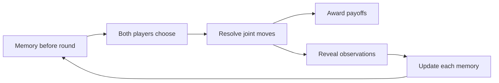

# From a square to a strategy

Start with two players and two choices. Then change one assumption at a time: let the players meet again, remember what happened, and respond differently.

This is a first teaching draft, not a simulator. The goal is to understand what each added rule makes possible, not to declare one strategy the winner.

## 1. Read the square

Two players choose **cooperate (C)** or **defect (D)** simultaneously. Neither sees the other's current choice before choosing. Each cell below contains **(Row's payoff, Column's payoff)**. Higher numbers are better.

| Row's choice | Column cooperates (C) | Column defects (D) |
| --- | --- | --- |
| **Row cooperates (C)** | **(3, 3)**: mutual cooperation | **(0, 5)**: Row is exploited |
| **Row defects (D)** | **(5, 0)**: Column is exploited | **(1, 1)**: mutual defection |

For Row, defecting gives 5 instead of 3 when Column cooperates, and 1 instead of 0 when Column defects. The same comparison holds for Column. Defection is therefore better for each player regardless of the other's choice. Yet both would get more at (C, C) than at (D, D). That tension is the [prisoner's dilemma](https://plato.stanford.edu/entries/prisoner-dilemma/).

**Checkpoint:** Cover Column's payoffs. Can you explain both of Row's comparisons without using the word "trust"?

## 2. Keep the structure, change the numbers

The numbers are an example, not the definition. A symmetric prisoner's dilemma can be written with four payoff parameters.

| Row's choice | Column cooperates (C) | Column defects (D) |
| --- | --- | --- |
| **Row cooperates (C)** | (R, R) | (S, T) |
| **Row defects (D)** | (T, S) | (P, P) |

T is the temptation payoff, R the reward for mutual cooperation, P the punishment for mutual defection, and S the sucker's payoff. The defining ordering is:

**T > R > P > S**

Our example sets T = 5, R = 3, P = 1, and S = 0. For repeated play, a common additional assumption is `2R > T + S`. It makes sustained mutual cooperation better for both players than equally alternating the exploiter role. Our numbers satisfy it: `6 > 5`. See the [discussion of repeated play](https://plato.stanford.edu/entries/prisoner-dilemma/#IndeIter).

Changing the numbers while preserving these conditions keeps this structure. Changing their ordering can produce a different kind of game.

## 3. Add time

Now play the same square for several rounds. A **move** is one choice this round. A **strategy** is a rule specifying choices across the possible histories of the interaction.

For a finite match, we can score each player by adding that player's round payoffs. Time alone does not guarantee cooperation. A commonly known, fixed final round gives the standard backward-induction argument for defection at every round under common knowledge of rational payoff maximization. This is a model result, not a claim that people always behave that way. See [finite iteration](https://plato.stanford.edu/entries/prisoner-dilemma/#FiniIter).

A fixed round count, an uncertain stopping time, and an infinite discounted interaction are different models. We must choose one before comparing long-run results.

## 4. Add memory

Suppose each player observes the completed pair of moves after every round. A player can now base the next move on past observations, but still cannot see the opponent's current choice.

| Strategy | First move | Later moves | What it needs to retain |
| --- | --- | --- | --- |
| Always cooperate | C | C | Nothing |
| Always defect | D | D | Nothing |
| Tit for tat | C | Copy the opponent's previous move | One previous opponent move |
| Grim trigger | C | D forever after any observed opponent defection; otherwise C | One flag: has the opponent ever defected? |

These are standard examples discussed in the [iterated-game literature](https://plato.stanford.edu/entries/prisoner-dilemma/#AxelTitForTat). Memory is not the same as keeping a transcript. Grim trigger reacts to any past defection, but only needs one persistent flag to do so.

Here is a four-round worked example. Row uses tit for tat; Column always defects. The strategies are stipulated, not claimed to be optimal for a four-round match.

| Round | Row | Column | Round payoffs (Row, Column) |
| --- | --- | --- | --- |
| 1 | C | D | (0, 5) |
| 2 | D | D | (1, 1) |
| 3 | D | D | (1, 1) |
| 4 | D | D | (1, 1) |
| **Total** | | | **(3, 8)** |

Tit for tat changes its behavior after the first round, but does not beat always defect in this match. A strategy's results depend on its opponent and the rules of the match. More memory is not automatically better.

**Checkpoint:** Replace Column with tit for tat. What moves occur, and what total does each player receive?

## 5. Describe the repeated process

A useful way to organize a more general model is to separate the game rules from the players' decision rules. The following is our proposed teaching framework, not a new theorem.

Specify these pieces explicitly:

- **Actions and payoffs.** Start with C, D, and the square above.
- **Time and scoring.** Decide when play ends and how round payoffs are combined.
- **Observations.** State what each player can see, and when.
- **Memory.** Define the information each player retains between rounds.
- **Strategy.** Map available information to a move, or a probability of each move.
- **Memory update.** State how new observations change retained information.

The square can remain unchanged while observations, memory, or stopping rules change. If we later let actions change the environment or future payoff squares, that is a further extension, not merely another memory setting.

## 6. Change one assumption next

These are directions for later lessons, not implemented features:

| Add | Question to investigate |
| --- | --- |
| An uncertain future | When can the prospect of future responses support cooperation? |
| Action errors | Can one accidental defection start a lasting retaliation cycle? |
| Imperfect observations | How should a player distinguish a mistaken report from a deliberate move? |
| Randomized responses | How does occasional forgiveness change recovery and exploitation? |
| A population of opponents | Does a strategy that does well in one pairing still do well across a tournament? |

No strategy is universally best across all opponent populations and rule choices. The [Stanford Encyclopedia's discussion of Axelrod's tournaments](https://plato.stanford.edu/entries/prisoner-dilemma/#AxelTitForTat) explains why the environment matters.

For each extension, return to the square, say exactly what changed, and work through a short trace before making a general claim.
